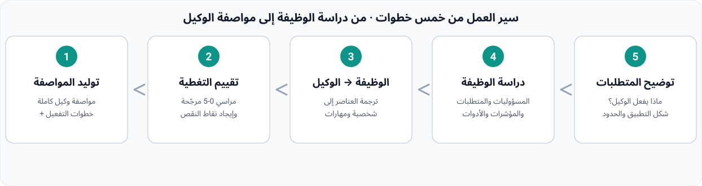

<div align="center" dir="rtl">


# Agent's HR · مهندس الوكلاء

### لا تعرف كيفية إنشاء وكيل ذكي؟ لا تستطيع توليد وكلاء فرعيين؟
**ادرس كيف تُصمَّم الوظائف في الواقع، ثم ترجم تصميم الوظيفة إلى شخصية الوكيل ومهاراته، لتوليد الوكيل المقابل مباشرة.**

<p>
  
  
  
  
  
</p>

</div>

---

## 📖 المحتويات

- [لماذا تحتاجه](#لماذا-تحتاجه)
- [القدرات الأساسية](#القدرات-الأساسية)
- [سير العمل من خمس خطوات](#سير-العمل-من-خمس-خطوات)
- [تقييم التغطية](#تقييم-التغطية)
- [البدء السريع](#البدء-السريع)
- [أمثلة الاستخدام](#أمثلة-الاستخدام)
- [إصدارات اللغات](#إصدارات-اللغات)
- [الالتزام بالممارسات المسؤولة](#الالتزام-بالممارسات-المسؤولة)
- [بنية المستودع](#بنية-المستودع)
- [الترخيص](#الترخيص)

---

## لماذا تحتاجه

تريد بناء وكيل ذكي (أو وكيل فرعي، أو مهارة) لكنك لا تعرف كيف تصممه، فتترك الوكيل العام يعمل عشوائيًا؟ منهج Agent's HR مبدأ واحد: **لا تصمم الوكيل من الفراغ — ادرس أولًا كيف صُمِّم أصحاب هذه الوظيفة في الواقع**. المسؤوليات والمتطلبات وسير العمل وواجهات التعاون ومؤشرات الأداء تُبحث كلها، ثم يُترجم تصميم الوظيفة عنصرًا بعنصر إلى تصميم الوكيل، لتخرج بمواصفة جاهزة للتطبيق.

| المشكلة | ما يفعله الوكيل العام | ما يفعله Agent's HR |
|:---|:---|:---|
| لا تعرف كيفية إنشاء وكيل / وكيل فرعي | يكتب المطالبات بالحسّ ويتركها للحظ | يدرس تصميم الوظيفة الواقعية ثم يولد الوكيل |
| تصميم بلا دليل | يخترع الشخصية والمهارات من العدم | كل قرار تصميم مرتبط بدليل من بحث الوظيفة (المصدر + التاريخ) |
| يفوّت عناصر الوظيفة | يكتب ما يخطر بباله | قائمة تحقق من ستة عناصر: المسؤوليات / المتطلبات / سير العمل / التعاون / المؤشرات / الأدوات |
| لا بوابة للجودة | «يبدو قابلًا للاستخدام» | مراسي تغطية 0-5 + تقييم مرجّح + نقض قاطع |
| لا يُطبَّق | نصائح فقط بلا مواصفة | مواصفة وكيل كاملة + شكل التطبيق وخطوات التفعيل |

---

## القدرات الأساسية

| # | القدرة | الوصف |
|:--|:---|:---|
| 1 | **بحث تصميم الوظيفة الواقعية** | بحث شامل عن كيفية تصميم الوظيفة: المسؤوليات من إعلانات حقيقية، المتطلبات، سير العمل اليومي، واجهات التعاون، المؤشرات، الأدوات؛ تحقق متقاطع من المصادر؛ وإذا لم يُعثر على شيء يُصرّح بذلك |
| 2 | **الوظيفة → الوكيل** | يترجم ستة عناصر وظيفية إلى عناصر تصميم الوكيل: الدور → الشخصية، المسؤوليات → المهارات وسير العمل، المتطلبات → مراسي القدرات والخطوط الحمراء، التعاون → مواصفة المدخلات والمخرجات، المؤشرات → معايير القبول، الأدوات → قائمة الأدوات |
| 3 | **تقييم تغطية التصميم** | 5-8 أبعاد تصميم بمراسي 0-5، وحساب مرجّح عبر `match_score.py`؛ النتيجة: درجة التغطية، ونقاط القوة، ونقاط النقص، وعلامات النقض |
| 4 | **توليد مواصفة الوكيل** | مواصفة كاملة بنمط «الخلاصة أولًا» (الواجهة الأمامية، الشخصية، المهارات، سير العمل، الأدوات، الخطوط الحمراء، معايير القبول) + شكل التطبيق (حزمة خبير / مهارة مستقلة / وكيل فرعي) وخطوات التفعيل |

---

## سير العمل من خمس خطوات



| الخطوة | المدخل | المخرج |
|:--|:---|:---|
| 1. توضيح المتطلبات | فكرة الوكيل من المستخدم | أربعة أسئلة: الغرض / السيناريو / شكل التطبيق / الحدود |
| 2. دراسة تصميم الوظيفة | المتطلبات | ملخص العناصر الستة + المصادر والتواريخ |
| 3. الوظيفة → الوكيل | ملخص تصميم الوظيفة | مسودة تصميم (الشخصية / المهارات / سير العمل / الأدوات / الحدود) |
| 4. تقييم التغطية | المسودة + أدلة الوظيفة | درجة التغطية + التصنيف + نقاط النقص والتوصيات |
| 5. توليد المواصفة | كل النتائج | مواصفة الوكيل الكاملة + شكل التطبيق وخطوات التفعيل |

---

## تقييم التغطية

التقييم يعتمد فقط على أدلة بحث الوظيفة؛ لا دليل = لا تقييم. المتوسط المرجّح × 20 = نسبة التغطية:

| التغطية | التصنيف | الإجراء |
|:--|:---|:---|
| ≥ 85 | **A · جاهز للتطبيق** | ابنِ مباشرة كحزمة خبير / مهارة / وكيل فرعي وفق المواصفة |
| 70 – 84 | **B · قابل للاستخدام أساسًا** | طبّق مع سد نقاط النقص (بحث أو تصميم إضافي) |
| 50 – 69 | **C · به نقاط نقص** | أكمل البحث أو التصميم أولًا، ثم طبّق |
| < 50 | **D · غير مطابق** | عُد إلى الخطوة 2 وأعد دراسة الوظيفة |
| عنصر أساسي ≤ 2 | **نقض قاطع** | D افتراضيًا مهما كانت النتيجة، إلا بإعفاء صريح من طالب التصميم |

---

## البدء السريع

### الطريقة الأولى: التثبيت كحزمة خبير (موصى به)

ثبّت هذا المستودع كحزمة خبير WorkBuddy:

```bash
# استنساخ المستودع
git clone https://github.com/xyzln/talent-sourcing-hr.git

# النسخ إلى مجلد الخبراء
cp -r talent-sourcing-hr ~/.workbuddy/plugins/marketplaces/my-experts/plugins/

# التسجيل (السكربت في مجلد scripts/ لمهارة expert-manager)
python3 register_expert.py ~/.workbuddy/plugins/marketplaces/my-experts/plugins/talent-sourcing-hr
```

ثم اختر **Agent's HR** من مركز الخبراء في WorkBuddy وصف الوكيل الذي تريد بناءه.

### الطريقة الثانية: استخدام المهارة منفردة

يمكن نسخ مجلد `skills/recruit-web-sourcing/` إلى `~/.workbuddy/skills/` للاستخدام المنفرد، أو تثبيت إصدار اللغة من SkillHub بالبحث عن `recruit-web-sourcing`.

---

## أمثلة الاستخدام

> لا تعرف كيفية إنشاء وكيل ذكي أو وكيل فرعي؟ أريد وكيلًا «يحلل سلوك المستخدمين ويُخرج استنتاجات قابلة للتنفيذ» — ادرس تصميم الوظيفة الواقعية وأولد الوكيل مباشرة.

> ادرس كيف تُصمَّم وظيفة «محلل بيانات» في الواقع: المسؤوليات والمتطلبات وسير العمل وواجهات التعاون والمؤشرات.

> ترجم تصميم الوظيفة هذا إلى مواصفة وكيل: الشخصية والمهارات والأدوات وسير العمل والخطوط الحمراء.

---

## إصدارات اللغات

| اللغة | README | مهارة SkillHub |
|:---|:---|:---|
| 🇨🇳 简体中文 | [README_CN.md](README_CN.md) | `recruit-web-sourcing-cn` |
| 🇹🇼 繁體中文 | [README_TW.md](README_TW.md) | `recruit-web-sourcing-tw` |
| 🇬🇧 English | [README_EN.md](README_EN.md) | `recruit-web-sourcing-en` |
| 🇷🇺 Русский | [README_RU.md](README_RU.md) | `recruit-web-sourcing-ru` |
| 🇸🇦 العربية | [README_AR.md](README_AR.md) | `recruit-web-sourcing-ar` |

كل إصدار لغوي يترجم بالكامل SKILL.md والأدلة الثلاثة ونصوص مخرجات سكربت التقييم.

---

## الالتزام بالممارسات المسؤولة

- بحث تصميم الوظيفة يعتمد **فقط على مصادر متاحة للعامة**؛ كل استنتاج يحمل مصدره وتاريخ الحصول، ولا شيء يُلفّق
- **لا نُصمم وكلاء للغش أو الاحتيال أو التمييز أو التحايل على التنظيم أو انتهاك الخصوصية**
- كل عنصر في تصميم الوكيل يجب أن يرجع لدليل من بحث الوظيفة؛ لا قدرات مُختلقة
- تقييم التغطية يعتمد على الأدلة فقط؛ لا دليل = 0 درجة مع علامة «بحاجة للتحقق»

---

## بنية المستودع

```text
talent-sourcing-hr/
├── README.md                        # نقطة الدخول (تبديل اللغات)
├── README_CN.md / _TW / _EN / _RU / _AR   # صفحات الهبوط بخمس لغات
├── assets/                          # الرسومات
│   ├── hero-agent-temp-worker.jpg   # رسم الشخصية الرئيسي
│   ├── talent-sourcing-network.jpg  # رسم مفهوم بحث تصميم الوظائف
│   └── workflow_{CN,TW,EN,RU,AR}.svg      # مخطط سير العمل (خمس لغات)
├── .codebuddy-plugin/plugin.json    # بيان حزمة الخبير
├── agents/talent-sourcing-hr.md     # شخصية الخبير (Agent's HR · غو شون)
├── avatars/expert.png               # صورة الخبير
├── skills/recruit-web-sourcing/     # مصدر المهارة (الصينية المبسطة)
│   ├── SKILL.md
│   ├── references/                  # دليل بحث الوظيفة / نموذج التحويل / قالب المواصفة
│   └── scripts/match_score.py       # حاسبة التغطية
├── i18n/{CN,TW,EN,RU,AR}/           # إصدارات المهارة الكاملة بخمس لغات
└── LICENSE
```

---

## الترخيص

[MIT](LICENSE) © 2026 talent-sourcing-hr contributors

<div align="center" dir="rtl">

**⭐ ضع نجمة ليعثر أكثر الناس، الذين لا يعرفون كيف يبنون وكلاء، على Agent's HR**

</div>
