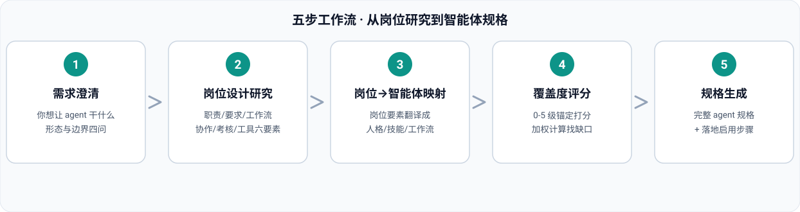

<div align="center">


# 招聘寻访官 · Talent Sourcing Officer

### 不会搭临时 agent？还在让 agent 碰运气？
**凭真实招聘经验与需求，精准匹配你的 agent 临时工。**

<p>
  
  
  
  
  
</p>

</div>

---

## 📖 目录

- [💡 为什么需要它](#-为什么需要它)
- [✨ 核心能力](#-核心能力)
- [🔄 五步工作流](#-五步工作流)
- [📊 匹配度评分](#-匹配度评分)
- [🚀 快速开始](#-快速开始)
- [💬 使用示例](#-使用示例)
- [🌐 多语言版本](#-多语言版本)
- [⚠️ 合规承诺](#️-合规承诺)
- [📁 仓库结构](#-仓库结构)
- [📄 开源协议](#-开源协议)

---

## 💡 为什么需要它

通用 agent 什么都答一点，招聘寻访却是个精细活：需求要拆解、渠道要覆盖、能力要对分、结论要可追溯。这个「agent 临时工」把整套方法论预制好了——你出业务要求，它出寻访结论。

| 痛点 | 通用 agent 的做法 | 招聘寻访官的做法 |
|:---|:---|:---|
| 不知道怎么设置临时 agent | 凭感觉写提示词，碰运气 | 方法论预制：五步流程 + 三份参考手册 |
| 需求模糊 | 直接开搜，搜出啥算啥 | 先结构化人才画像，缺失信息先提问 |
| 检索没章法 | 一两个关键词碰运气 | 关键词矩阵 × 渠道分层，多轮交叉验证 |
| 匹配靠感觉 | 「看起来挺合适」 | 0-5 级行为锚定 + 加权评分 + 一票否决 |
| 结论不可追溯 | 说得热闹，没有信源 | 每个判断挂证据，行情数据标注获取时间 |

---

## ✨ 核心能力

| # | 能力 | 说明 |
|:--|:---|:---|
| 1 | **业务要求结构化** | 把「要个能扛事的后端」这类口语要求，转成结构化人才画像：硬性条件、能力维度、权重、一票否决项 |
| 2 | **全网检索寻访** | 关键词矩阵 + 渠道分层（招聘站点 / 社交社区 / 竞对动态 / 行业报告），多轮检索，交叉验证供给密度与薪资行情 |
| 3 | **能力建模与精准匹配** | 5-8 个可评分能力维度、0-5 级行为锚定量表、`match_score.py` 加权计算，输出匹配度分级、优势项、缺口项 |
| 4 | **寻访报告输出** | 结论先行：供给概况、Top 匹配线索表、触达建议、风险备选、72 小时行动清单 |

---

## 🔄 五步工作流



| 步骤 | 输入 | 输出 |
|:--|:---|:---|
| 1. 需求结构化 | 业务要求 / JD | 人才画像（硬性条件 + 能力维度 + 权重） |
| 2. 检索策略 | 人才画像 | 关键词矩阵 + 渠道清单 + 检索轮次 |
| 3. 全网检索 | 检索策略 | 命中记录（信源 + 时间 + 质量评级） |
| 4. 能力匹配 | 候选线索 + 能力模型 | 匹配度总分 + 优势项 + 缺口项 |
| 5. 寻访报告 | 全部结果 | 结论先行的寻访报告 + 72 小时行动清单 |

---

## 📊 匹配度评分

评分只基于公开渠道证据，无证据不评分。加权平均 × 20 = 匹配度百分制：

| 匹配度 | 分级 | 行动建议 |
|:--|:---|:---|
| ≥ 85 | **A · 优先寻访** | 立即触达，准备定向话术 |
| 70 – 84 | **B · 可培养** | 触达同时评估缺口项培养成本 |
| 50 – 69 | **C · 谨慎** | 供给紧张时作为替代人选 |
| < 50 | **D · 不匹配** | 不进入寻访清单 |
| 必备项 ≤ 2 分 | **一票否决** | 无论总分默认 D，除非业务方明确豁免 |

---

## 🚀 快速开始

### 方式一：安装为专家包（推荐）

把本仓库作为 WorkBuddy 专家包安装：

```bash
# 克隆仓库
git clone https://github.com/xyzln/talent-sourcing-hr.git

# 复制到专家目录
cp -r talent-sourcing-hr ~/.workbuddy/plugins/marketplaces/my-experts/plugins/

# 注册（脚本位于 expert-manager 技能的 scripts/ 目录）
python3 register_expert.py ~/.workbuddy/plugins/marketplaces/my-experts/plugins/talent-sourcing-hr
```

然后在 WorkBuddy 专家中心选择「**招聘寻访官**」，直接提业务要求即可。

### 方式二：单独使用技能

技能目录 `skills/recruit-web-sourcing/` 可独立复制到 `~/.workbuddy/skills/` 使用，或在 SkillHub 搜索 `recruit-web-sourcing` 安装对应语言版本。

---

## 💬 使用示例

> 我是业务负责人，这是我们的岗位需求和业务要求，请全网检索并精准匹配人才，给出寻访结论。

> 拆解这个岗位的能力模型，给出筛选标准和匹配评分表。

> 汇总近期目标行业的招聘需求动态，输出人才市场洞察简报。

---

## 🌐 多语言版本

| 语言 | README | SkillHub 技能 |
|:---|:---|:---|
| 🇨🇳 简体中文 | [README_CN.md](README_CN.md) | `recruit-web-sourcing` |
| 🇹🇼 繁體中文 | [README_TW.md](README_TW.md) | `recruit-web-sourcing-tw` |
| 🇬🇧 English | [README_EN.md](README_EN.md) | `recruit-web-sourcing-en` |
| 🇷🇺 Русский | [README_RU.md](README_RU.md) | `recruit-web-sourcing-ru` |
| 🇸🇦 العربية | [README_AR.md](README_AR.md) | `recruit-web-sourcing-ar` |

各语言版本完整翻译了 SKILL.md、三份参考手册与评分脚本的输出文案。

---

## ⚠️ 合规承诺

- 筛选与匹配**只基于岗位相关能力与公开渠道证据**，不涉及年龄、性别、地域、婚育、户籍等歧视性维度
- **不编造信源与候选人**，检索不到会如实说明并给出扩搜建议
- 只使用公开渠道信息，保护候选人隐私
- 所有结论标注信源与获取时间

---

## 📁 仓库结构

```text
talent-sourcing-hr/
├── README.md                        # 入口（语言切换）
├── README_CN.md / _TW / _EN / _RU / _AR   # 五语言落地页
├── assets/                          # 配图
│   ├── hero-agent-temp-worker.jpg   # 人设主图
│   ├── talent-sourcing-network.jpg  # 全网检索概念图
│   └── workflow_{CN,TW,EN,RU,AR}.svg      # 五步流程图（五语言）
├── .codebuddy-plugin/plugin.json    # 专家包清单
├── agents/talent-sourcing-hr.md     # 专家人格（招聘寻访官·顾寻）
├── avatars/expert.png               # 专家头像
├── skills/recruit-web-sourcing/     # 技能源码（简体中文）
│   ├── SKILL.md
│   ├── references/                  # 检索手册 / 匹配模型 / 报告模板
│   └── scripts/match_score.py       # 匹配度计算器
├── i18n/{CN,TW,EN,RU,AR}/           # 五语言技能完整版本
└── LICENSE
```

---

## 📄 开源协议

[MIT](LICENSE) © 2026 talent-sourcing-hr contributors

<div align="center">

**⭐ 觉得好用就点个 Star，让更多被 agent 碰运气折磨的人找到这个临时工**

</div>
