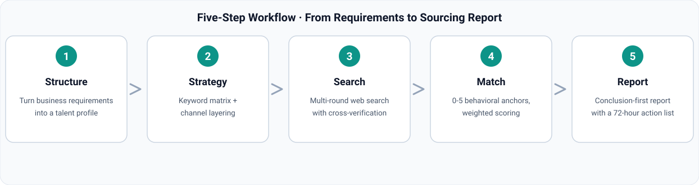

<div align="center">


# Talent Sourcing Officer

### Don't know how to set up a temporary agent? Still letting agents guess?
**A precisely matched agent temp worker, built on real recruiting experience and business requirements.**

<p>
  
  
  
  
  
</p>

</div>

---

## 📖 Table of Contents

- [💡 Why This Exists](#-why-this-exists)
- [✨ Core Capabilities](#-core-capabilities)
- [🔄 Five-Step Workflow](#-five-step-workflow)
- [📊 Match Scoring](#-match-scoring)
- [🚀 Quick Start](#-quick-start)
- [💬 Example Prompts](#-example-prompts)
- [🌐 Language Versions](#-language-versions)
- [⚠️ Compliance Commitment](#️-compliance-commitment)
- [📁 Repository Structure](#-repository-structure)
- [📄 License](#-license)

---

## 💡 Why This Exists

Generic agents answer everything a little; talent sourcing demands precision: requirements must be decomposed, channels must be covered, capabilities must be scored, and conclusions must be traceable. This agent temp worker ships with the full methodology pre-built — you bring the business requirements, it brings the sourcing report.

| Pain point | Generic agent | Talent Sourcing Officer |
|:---|:---|:---|
| Don't know how to set up a temporary agent | Prompt by feel, hope for luck | Methodology pre-built: 5-step workflow + 3 reference manuals |
| Fuzzy requirements | Search first, ask never | Structures a talent profile first; asks when info is missing |
| No search discipline | One or two keywords, crossed fingers | Keyword matrix × channel layering, multi-round cross-verified search |
| Matching by gut feel | "Looks like a good fit" | 0-5 behavioral anchors + weighted scoring + hard vetoes |
| Untraceable conclusions | Sounds convincing, no sources | Every claim tied to evidence; market data timestamped |

---

## ✨ Core Capabilities

| # | Capability | Description |
|:--|:---|:---|
| 1 | **Requirement Structuring** | Turns colloquial asks ("we need a backend who can handle pressure") into a structured talent profile: hard requirements, capability dimensions, weights, veto items |
| 2 | **Web-Wide Sourcing** | Keyword matrix + channel layering (job boards / social & pro communities / competitor moves / industry reports), multi-round search, cross-verified supply density and salary benchmarks |
| 3 | **Capability Modeling & Matching** | 5-8 scoreable dimensions, 0-5 behavioral anchor scale, `match_score.py` weighted computation → match grade, strengths, gaps |
| 4 | **Sourcing Report** | Conclusion-first: supply overview, top candidate-lead table, outreach advice, risk fallbacks, 72-hour action list |

---

## 🔄 Five-Step Workflow



| Step | Input | Output |
|:--|:---|:---|
| 1. Structure | Business requirements / JD | Talent profile (hard reqs + dimensions + weights) |
| 2. Strategy | Talent profile | Keyword matrix + channel list + search rounds |
| 3. Search | Search strategy | Hit log (source + date + quality rating) |
| 4. Match | Candidate leads + capability model | Match score + strengths + gaps |
| 5. Report | All results | Conclusion-first sourcing report + 72-hour action list |

---

## 📊 Match Scoring

Scores are based on public-channel evidence only — no evidence, no score. Weighted average × 20 = match score (0-100):

| Score | Grade | Recommended action |
|:--|:---|:---|
| ≥ 85 | **A · Priority outreach** | Reach out immediately with tailored messaging |
| 70 – 84 | **B · Developable** | Reach out while sizing the cost of closing gaps |
| 50 – 69 | **C · Caution** | Fallback option when supply is tight |
| < 50 | **D · No match** | Keep off the sourcing list |
| Any must-have ≤ 2 | **Hard veto** | Defaults to D unless the business owner explicitly waives |

---

## 🚀 Quick Start

### Option 1: Install as an expert package (recommended)

Install this repository as a WorkBuddy expert package:

```bash
# Clone the repo
git clone https://github.com/xyzln/talent-sourcing-hr.git

# Copy into the experts directory
cp -r talent-sourcing-hr ~/.workbuddy/plugins/marketplaces/my-experts/plugins/

# Register (script lives in the expert-manager skill's scripts/ directory)
python3 register_expert.py ~/.workbuddy/plugins/marketplaces/my-experts/plugins/talent-sourcing-hr
```

Then pick **Talent Sourcing Officer** in the WorkBuddy expert center and state your business requirements — that's it.

### Option 2: Use the skill standalone

The `skills/recruit-web-sourcing/` directory can be copied to `~/.workbuddy/skills/` for standalone use, or install a language version from SkillHub by searching `recruit-web-sourcing`.

---

## 💬 Example Prompts

> I'm the business owner. Here are our role requirements and business needs — search the web, match talent precisely, and give me sourcing conclusions.

> Break down the capability model for this role, with screening criteria and a matching scorecard.

> Summarize recent hiring demand trends in the target industry and output a talent market briefing.

---

## 🌐 Language Versions

| Language | README | SkillHub skill |
|:---|:---|:---|
| 🇨🇳 简体中文 | [README_CN.md](README_CN.md) | `recruit-web-sourcing-cn` |
| 🇹🇼 繁體中文 | [README_TW.md](README_TW.md) | `recruit-web-sourcing-tw` |
| 🇬🇧 English | [README_EN.md](README_EN.md) | `recruit-web-sourcing-en` |
| 🇷🇺 Русский | [README_RU.md](README_RU.md) | `recruit-web-sourcing-ru` |
| 🇸🇦 العربية | [README_AR.md](README_AR.md) | `recruit-web-sourcing-ar` |

Every language version fully translates the SKILL.md, all three reference manuals, and the scoring script's output strings.

---

## ⚠️ Compliance Commitment

- Screening and matching rely **only on job-relevant capabilities and public-channel evidence** — no age, gender, region, marital, or household-registration dimensions
- **No fabricated sources or candidates** — if a search comes up empty, we say so and suggest how to widen it
- Public information only; candidate privacy is protected
- Every conclusion carries its source and retrieval date

---

## 📁 Repository Structure

```text
talent-sourcing-hr/
├── README.md                        # Entry point (language switcher)
├── README_CN.md / _TW / _EN / _RU / _AR   # Five-language landing pages
├── assets/                          # Illustrations
│   ├── hero-agent-temp-worker.jpg   # Character hero art
│   ├── talent-sourcing-network.jpg  # Web-sourcing concept art
│   └── workflow_{CN,TW,EN,RU,AR}.svg      # Five-step workflow diagram (5 languages)
├── .codebuddy-plugin/plugin.json    # Expert package manifest
├── agents/talent-sourcing-hr.md     # Expert persona (Gu Xun, sourcing officer)
├── avatars/expert.png               # Expert avatar
├── skills/recruit-web-sourcing/     # Skill source (Simplified Chinese)
│   ├── SKILL.md
│   ├── references/                  # Search playbook / matching model / report template
│   └── scripts/match_score.py       # Match score calculator
├── i18n/{CN,TW,EN,RU,AR}/           # Full five-language skill versions
└── LICENSE
```

---

## 📄 License

[MIT](LICENSE) © 2026 talent-sourcing-hr contributors

<div align="center">

**⭐ Star this repo if it helps — let more people burned by agent guesswork find their temp worker**

</div>
