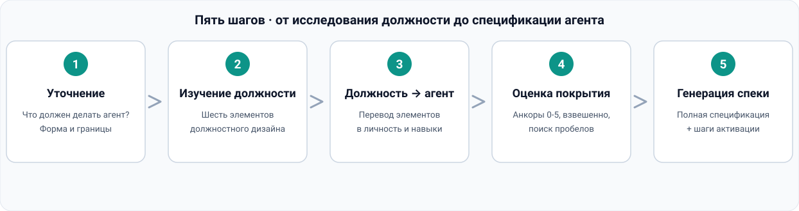

<div align="center">


# Agent's HR · Архитектор агентов

### Не знаете, как создать агента? Не умеете генерировать подагентов?
**Изучите, как устроена реальная должность, переведите должностной дизайн в личность и навыки агента — и получите готового агента.**

<p>
  
  
  
  
  
</p>

</div>

---

## 📖 Содержание

- [Зачем он нужен](#зачем-он-нужен)
- [Ключевые возможности](#ключевые-возможности)
- [Рабочий процесс из пяти шагов](#рабочий-процесс-из-пяти-шагов)
- [Оценка покрытия](#оценка-покрытия)
- [Быстрый старт](#быстрый-старт)
- [Примеры использования](#примеры-использования)
- [Языковые версии](#языковые-версии)
- [Соответствие нормам](#соответствие-нормам)
- [Структура репозитория](#структура-репозитория)
- [Лицензия](#лицензия)

---

## Зачем он нужен

Хотите создать агента (или подагента, или навык), но не знаете, как его спроектировать, — и отдаёте это generic-агенту на самотёк? У Agent's HR один принцип: **не проектировать агента из головы — сначала изучить, как устроены реальные люди на этой должности**. Обязанности, требования, рабочий процесс, интерфейсы взаимодействия и метрики — всё исследуется, а затем должностной дизайн поэлементно переводится в дизайн агента, и на выходе — спецификация, которую можно сразу внедрять.

| Боль | Что делает generic-агент | Что делает Agent's HR |
|:---|:---|:---|
| Не знаете, как создать агента / подагента | Пишет промпты на ощупь, надеется на удачу | Изучает реальную должность, затем генерирует агента |
| Дизайн без доказательств | Придумывает личность и навыки из воздуха | Каждое Design-решение опирается на исследование должности (источник + дата) |
| Упускает элементы должности | Пишет, что приходит в голову | Чек-лист из шести элементов: обязанности / требования / процесс / взаимодействие / метрики / инструменты |
| Нет проверки качества | «Вроде работает» | Анкоры покрытия 0-5 + взвешенная оценка + жёсткое вето |
| Не внедряется | Только советы, без спецификации | Полная спецификация агента + форма внедрения и шаги активации |

---

## Ключевые возможности

| # | Возможность | Описание |
|:--|:---|:---|
| 1 | **Исследование дизайна реальной должности** | Веб-поиск устройства должности: обязанности из реальных JD, требования, ежедневный процесс, интерфейсы взаимодействия, метрики, инструменты; перекрёстная проверка источников; если ничего не найдено — честно об этом скажет |
| 2 | **Должность → агент** | Переводит шесть элементов должности в элементы дизайна агента: роль → личность, обязанности → навыки и процесс, требования → анкоры компетенций и красные линии, взаимодействие → спецификация ввода-вывода, метрики → критерии приёмки, инструменты → список инструментов |
| 3 | **Оценка покрытия дизайна** | 5-8 измерений дизайна по анкорам 0-5, взвешенный расчёт через `match_score.py`; на выходе — grade покрытия, сильные позиции, пробелы и отметки вето |
| 4 | **Генерация спецификации агента** | Спецификация «сначала вывод» (frontmatter, личность, навыки, процесс, инструменты, красные линии, критерии приёмки) + форма внедрения (экспертный пакет / отдельный навык / подагент) и шаги активации |

---

## Рабочий процесс из пяти шагов



| Шаг | Ввод | Вывод |
|:--|:---|:---|
| 1. Уточнение потребностей | Идея агента от пользователя | Четыре вопроса: назначение / сценарий / форма внедрения / границы |
| 2. Исследование должности | Потребности | Сводка по шести элементам + источники и даты |
| 3. Должность → агент | Сводка дизайна должности | Черновик дизайна (личность / навыки / процесс / инструменты / границы) |
| 4. Оценка покрытия | Черновик + доказательства по должности | Итог покрытия + grade + пробелы и рекомендации |
| 5. Генерация спецификации | Все результаты | Полная спецификация агента + форма внедрения и шаги активации |

---

## Оценка покрытия

Оценки — только по доказательствам из исследования должности; нет доказательств — нет оценки. Взвешенное среднее × 20 = покрытие в процентах:

| Покрытие | Grade | Действие |
|:--|:---|:---|
| ≥ 85 | **A · Можно внедрять** | Сразу собирать экспертный пакет / навык / подагента по спецификации |
| 70 – 84 | **B · В целом работоспособно** | Внедрять, параллельно закрывая пробелы (доп. исследование или доп. дизайн) |
| 50 – 69 | **C · Есть пробелы** | Сначала дозакрыть исследование или дизайн, потом внедрять |
| < 50 | **D · Не подходит** | Вернуться к шагу 2 и переисследовать должность |
| Ключевой пункт ≤ 2 | **Жёсткое вето** | По умолчанию D независимо от итога, если заказчик явно не отказался от вето |

---

## Быстрый старт

### Способ 1: установить как экспертный пакет (рекомендуется)

Установите этот репозиторий как экспертный пакет WorkBuddy:

```bash
# Клонировать репозиторий
git clone https://github.com/xyzln/talent-sourcing-hr.git

# Скопировать в каталог экспертов
cp -r talent-sourcing-hr ~/.workbuddy/plugins/marketplaces/my-experts/plugins/

# Зарегистрировать (скрипт в каталоге scripts/ навыка expert-manager)
python3 register_expert.py ~/.workbuddy/plugins/marketplaces/my-experts/plugins/talent-sourcing-hr
```

Затем выберите **Agent's HR** в центре экспертов WorkBuddy и опишите агента, которого хотите получить.

### Способ 2: использовать навык отдельно

Каталог `skills/recruit-web-sourcing/` можно скопировать в `~/.workbuddy/skills/` для автономного использования или установить языковую версию с SkillHub, найдя `recruit-web-sourcing`.

---

## Примеры использования

> Не знаете, как создать агента или подагента? Хочу агента, который «анализирует поведение пользователей и выдаёт выводы, пригодные к действию» — исследуй реальную должность и сгенерируй агента.

> Исследуй, как в реальности устроена должность «аналитик данных»: обязанности, требования, процесс, интерфейсы взаимодействия и метрики.

> Переведи этот должностной дизайн в спецификацию агента: личность, навыки, инструменты, процесс и красные линии.

---

## Языковые версии

| Язык | README | Навык на SkillHub |
|:---|:---|:---|
| 🇨🇳 简体中文 | [README_CN.md](README_CN.md) | `recruit-web-sourcing-cn` |
| 🇹🇼 繁體中文 | [README_TW.md](README_TW.md) | `recruit-web-sourcing-tw` |
| 🇬🇧 English | [README_EN.md](README_EN.md) | `recruit-web-sourcing-en` |
| 🇷🇺 Русский | [README_RU.md](README_RU.md) | `recruit-web-sourcing-ru` |
| 🇸🇦 العربية | [README_AR.md](README_AR.md) | `recruit-web-sourcing-ar` |

Каждая языковая версия полностью переводит SKILL.md, три справочника и выводы скрипта оценки.

---

## Соответствие нормам

- Исследование должности опирается **только на публично доступные источники**; каждая вывод снабжён источником и датой получения, ничего не выдумывается
- **Не проектируем агентов для мошенничества, обмана, дискриминации, обхода регулирования или нарушения приватности**
- Каждый элемент дизайна агента опирается на доказательства из исследования должности; никаких выдуманных способностей
- Оценки покрытия — только по доказательствам; нет доказательств = 0 баллов и отметка «требует проверки»

---

## Структура репозитория

```text
talent-sourcing-hr/
├── README.md                        # Входная точка (переключение языков)
├── README_CN.md / _TW / _EN / _RU / _AR   # Лендинги на пяти языках
├── assets/                          # Иллюстрации
│   ├── hero-agent-temp-worker.jpg   # Главная иллюстрация персонажа
│   ├── talent-sourcing-network.jpg  # Иллюстрация исследования должностей
│   └── workflow_{CN,TW,EN,RU,AR}.svg      # Диаграмма процесса (5 языков)
├── .codebuddy-plugin/plugin.json    # Манифест экспертного пакета
├── agents/talent-sourcing-hr.md     # Личность эксперта (Agent's HR · Гу Сюнь)
├── avatars/expert.png               # Аватар эксперта
├── skills/recruit-web-sourcing/     # Исходник навыка (упрощённый китайский)
│   ├── SKILL.md
│   ├── references/                  # Пособие по исследованию / модель маппинга / шаблон спецификации
│   └── scripts/match_score.py       # Калькулятор покрытия
├── i18n/{CN,TW,EN,RU,AR}/           # Полные версии навыка на пяти языках
└── LICENSE
```

---

## Лицензия

[MIT](LICENSE) © 2026 talent-sourcing-hr contributors

<div align="center">

**⭐ Поставьте Star, чтобы больше людей, не знающих, как создавать агентов, нашли Agent's HR**

</div>
