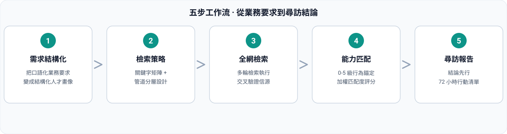

<div align="center">


# Agent's HR · 智能體設計師

### 不知道怎麼建立智能體？不會生成子 agent？
**先研究現實崗位是怎麼設計的，再把崗位設計翻譯成 agent 人格與技能，直接生成對應智能體。**

<p>
  
  
  
  
  
</p>

</div>

---

## 📖 目錄

- [💡 為什麼需要它](#-為什麼需要它)
- [✨ 核心能力](#-核心能力)
- [🔄 五步工作流](#-五步工作流)
- [📊 覆蓋度評分](#-覆蓋度評分)
- [🚀 快速開始](#-快速開始)
- [💬 使用範例](#-使用範例)
- [🌐 多語言版本](#-多語言版本)
- [⚠️ 合規承諾](#️-合規承諾)
- [📁 倉庫結構](#-倉庫結構)
- [📄 開源協定](#-開源協定)

---

## 💡 為什麼需要它

想造個 agent（或子 agent、技能），卻不知道怎么設計，只能讓通用 agent 碰運氣？Agent's HR 的方法論只有一條：**不憑空設計 agent，先去看現實中幹這活的人是怎麼被設計的**。崗位職責、任職要求、工作流、協作介面、考核指標全部查清楚，再把崗位設計逐項翻譯成 agent 設計，直接產出能落地的智能體規格。

| 痛點 | 通用 agent 的做法 | Agent's HR 的做法 |
|:---|:---|:---|
| 不知道怎么建立智能體 / 子 agent | 憑感覺寫提示詞，碰運氣 | 先研究現實崗位怎麼設計的，再生成 agent |
| 設計沒有依據 | 拍腦袋編人格和技能 | 每項設計追溯到崗位研究證據（信源 + 取得時間） |
| 崗位要素抓不全 | 想到哪寫到哪 | 六要素採集清單：職責 / 任職要求 / 工作流 / 協作介面 / 考核指標 / 工具棧 |
| 設計品質沒驗收 | 「看起來能用」 | 0-5 級覆蓋度錨定 + 加權評分 + 一票否決 |
| 落不了地 | 只給建議不給規格 | 輸出完整 agent 規格 + 落地方式與啟用步驟 |

---

## ✨ 核心能力

| # | 能力 | 說明 |
|:--|:---|:---|
| 1 | **現實崗位設計研究** | 全網檢索對應崗位的設計：真實 JD 的職責拆解、任職要求、日常工作流、協作介面、考核指標、工具棧；多源交叉驗證，查不到如實說明 |
| 2 | **崗位 → 智能體映射** | 把六大崗位要素逐項翻譯成 agent 設計要素：角色定位→人格、職責→技能與工作流、任職要求→能力錨定與鐵律、協作介面→輸入輸出規格、考核指標→驗收標準、工具棧→工具清單 |
| 3 | **設計覆蓋度評分** | 5-8 個設計維度 0-5 級錨定打分，`match_score.py` 加權計算，輸出覆蓋度分級、強覆蓋項、缺口項與一票否決標記 |
| 4 | **Agent 規格生成** | 結論先行輸出完整智能體設計規格（frontmatter、人格、技能、工作流、工具、邊界鐵律、驗收標準），並給出落地方式（專家包 / 獨立技能 / 子 agent）與啟用步驟 |

---

## 🔄 五步工作流



| 步驟 | 輸入 | 輸出 |
|:--|:---|:---|
| 1. 需求澄清 | 使用者的 agent 想法 | 用途 / 場景 / 落地形態 / 邊界四問 |
| 2. 崗位設計研究 | 需求 | 六要素研究摘要 + 信源與取得時間 |
| 3. 崗位 → 智能體映射 | 崗位設計摘要 | 設計草案（人格 / 技能 / 工作流 / 工具 / 邊界） |
| 4. 覆蓋度評分 | 設計草案 + 崗位證據 | 覆蓋度總分 + 分級 + 缺口項與補齊建議 |
| 5. 規格生成 | 全部結果 | 完整 agent 規格 + 落地方式與啟用步驟 |

---

## 📊 覆蓋度評分

評分只基於崗位研究證據，無證據不評分。加權平均 × 20 = 覆蓋度百分制：

| 覆蓋度 | 分級 | 行動建議 |
|:--|:---|:---|
| ≥ 85 | **A · 可直接落地** | 按規格直接建成專家包 / 技能 / 子 agent |
| 70 – 84 | **B · 基本可用** | 落地同時補齊缺口項（補研究或補設計） |
| 50 – 69 | **C · 有缺口** | 先補崗位研究或補設計，再落地 |
| < 50 | **D · 不匹配** | 回到第 2 步重新研究崗位 |
| 核心項 ≤ 2 分 | **一票否決** | 無論總分預設 D，除非需求方明確豁免 |

---

## 🚀 快速開始

### 方式一：安裝為專家包（推薦）

把本倉庫作為 WorkBuddy 專家包安裝：

```bash
# 複製倉庫
git clone https://github.com/xyzln/talent-sourcing-hr.git

# 複製到專家目錄
cp -r talent-sourcing-hr ~/.workbuddy/plugins/marketplaces/my-experts/plugins/

# 註冊（腳本位於 expert-manager 技能的 scripts/ 目錄）
python3 register_expert.py ~/.workbuddy/plugins/marketplaces/my-experts/plugins/talent-sourcing-hr
```

然後在 WorkBuddy 專家中心選擇「**Agent's HR**」，直接說你想造個什麼 agent 即可。

### 方式二：單獨使用技能

技能目錄 `skills/recruit-web-sourcing/` 可獨立複製到 `~/.workbuddy/skills/` 使用，或在 SkillHub 搜尋 `recruit-web-sourcing` 安裝對應語言版本。

---

## 💬 使用範例

> 不知道怎么建立智能體或子 agent？我想讓這個 agent 幹「使用者行為分析並輸出可執行結論」，幫我研究現實崗位怎麼設計，直接生成 agent。

> 研究一下「資料分析師」這個崗位在現實中是怎麼設計的：職責、任職要求、工作流、協作介面和考核指標。

> 把這個崗位的設計翻譯成 agent 規格：人格、技能、工具、工作流和邊界鐵律。

---

## 🌐 多語言版本

| 語言 | README | SkillHub 技能 |
|:---|:---|:---|
| 🇨🇳 简体中文 | [README_CN.md](README_CN.md) | `recruit-web-sourcing-cn` |
| 🇹🇼 繁體中文 | [README_TW.md](README_TW.md) | `recruit-web-sourcing-tw` |
| 🇬🇧 English | [README_EN.md](README_EN.md) | `recruit-web-sourcing-en` |
| 🇷🇺 Русский | [README_RU.md](README_RU.md) | `recruit-web-sourcing-ru` |
| 🇸🇦 العربية | [README_AR.md](README_AR.md) | `recruit-web-sourcing-ar` |

各語言版本完整翻譯了 SKILL.md、三份參考手冊與評分腳本的輸出文案。

---

## ⚠️ 合規承諾

- 崗位設計研究**只依據公開可查信源**，所有結論標註信源與取得時間，不編造
- **不設計用於作弊、欺詐、歧視、繞過監管或侵犯隱私的 agent**
- agent 的每項設計必須來自崗位研究證據，不憑空發明能力
- 覆蓋度評分只基於證據，無證據 = 0 分並標註「待驗證」

---

## 📁 倉庫結構

```text
talent-sourcing-hr/
├── README.md                        # 入口（語言切換）
├── README_CN.md / _TW / _EN / _RU / _AR   # 五語言落地頁
├── assets/                          # 配圖
│   ├── hero-agent-temp-worker.jpg   # 人設主圖
│   ├── talent-sourcing-network.jpg  # 崗位設計研究概念圖
│   └── workflow_{CN,TW,EN,RU,AR}.svg      # 五步流程圖（五語言）
├── .codebuddy-plugin/plugin.json    # 專家包清單
├── agents/talent-sourcing-hr.md     # 專家人格（Agent's HR · 顧尋）
├── avatars/expert.png               # 專家頭像
├── skills/recruit-web-sourcing/     # 技能源碼（簡體中文）
│   ├── SKILL.md
│   ├── references/                  # 崗位設計研究手冊 / 映射模型 / 設計規格模板
│   └── scripts/match_score.py       # 覆蓋度計算器
├── i18n/{CN,TW,EN,RU,AR}/           # 五語言技能完整版本
└── LICENSE
```

---

## 📄 開源協定

[MIT](LICENSE) © 2026 talent-sourcing-hr contributors

<div align="center">

**⭐ 覺得好用就點個 Star，讓更多不知道怎么建 agent 的人找到 Agent's HR**

</div>
